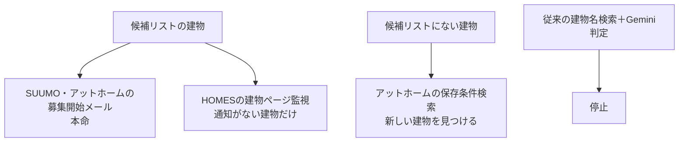

# 監視の作り直し 仕様メモ（2026-11-18〜）

仕様を決めている途中。決まったものだけ「決定」に書く。実装は仕様が決まってから。

## 決定

- 従来の検索（建物名を Yahoo 等で検索して Gemini で判定）は停止する
- 本命は不動産情報サイトの通知メール（SUUMO・アットホームの建物ごとの募集開始の登録）
- アットホームの条件検索は「通知の漏れ拾い」ではなく、候補リストにない建物の良い募集を見つけるためのもの（アットホームの募集は建物名・番地が載らないことが多く、建物で登録できないため）
- オフィシーは使わない
- **HOMESの建物ページ監視はやる**（2026-11-18）
  - 対象：SUUMO・アットホームに建物ページがない119棟のうち、HOMESで名前と番地が合った72棟。番地だけ合った21棟は確認してから足す（outputs/homes-match-119.json）
  - 動かす場所：**Cloudflare Workers（クラウド）**。2026-11-18 のテストで、Cloudflare Workers から HOMES の建物ページ2件を取得できた（HTTP 200、約36〜40万文字、本物のページの題名）。GitHub Actions からは弾かれる。このPCからもブラウザなしで取れる（予備）
  - 読むのは建物ページの「募集中の部屋」の欄だけ（周りの別物件を拾う誤検知を避ける）
  - CAPTCHA が出たら止まる（当方は押せない）
- **頻度は1日4回、8時5分・12時5分・15時5分・18時5分**（2026-11-18。当初の3回から午後を厚くするため変更。毎時0分は GitHub Actions が混むので5分ずらす。混雑で10〜30分遅れることはある。13時台の回は足さない〈キリがないので、とりあえず4回〉。どの回で新着が見つかったかは記録しておく）
- **知らせる先は Discord の既存のチャンネル**（2026-11-18）。試運転で今の監視と並べて動かす間は、新しい監視の通知の頭に【新監視】と付けて見分ける
- **家賃は管理費・共益費などを含めた額で判定する**（本線の20万円、変化球の13万円とも。2026-11-18）
- **アットホームの今の保存条件（2026-11-18 確認）**：①貸店舗・東京都全域・坪1.3万円以下・10㎡以上・徒歩10分以内（5/20）②貸店舗・高田馬場・坪1.8万円以下・20㎡以上・徒歩7分以内（7/23）③貸店舗・神田・同（7/23）④倉庫・23区と多摩の市・賃料20万円以下・20㎡以上・徒歩10分以内（6/10）。業種は絞っていない。貸事務所の条件は無い
- **本線の坪単価は1.5万円以下にする**（保存条件①は1.3万円だが、ユーザーが1.5万円と決定。2026-11-18）
- **今の保存条件は4つとも定時の検索に入れる**（2026-11-18）
- **貸事務所も検索に入れる。倉庫もスタジオに使える可能性があるので対象**（2026-11-18）
- **スタジオ用の広さの下限は、とりあえず10㎡**（2026-11-18）
- **今の監視（検索・建物ページ監視）は、新しい監視が動いたら止める**（2026-11-18。「ほぼ役に立ってない」）
- **goo 住宅・不動産はアットホームが片付いてから**（2026-11-18）
- **エリアの基本：山手線の内側は鉄板。隅田川より西の23区は圏内**（2026-11-18）。重点エリアはユーザーも決めかねている。サロンとスタジオで重点エリアは違う
- **月島・勝どきは対象。麻布十番・六本木は「超やりたい」（重点）。自由が丘は外さない**（2026-11-18）
- **坪2.5万円まで広げるのは、もっとピンポイント**（2026-11-18 訂正）：銀座・丸の内エリア（銀座・銀座一丁目・東銀座・有楽町・京橋・東京・大手町・二重橋前・日比谷）、渋谷・新宿・池袋の駅徒歩3分以内（1分に近いほど高評価）、秋葉原・神田・御茶ノ水まわり（「最高」。岩本町・淡路町・小川町・新御茶ノ水・末広町・湯島を含む）、上野・御徒町（「いい」）、赤坂・赤坂見附・乃木坂・六本木・六本木一丁目・麻布十番（「垂涎エリア」。2026-11-18 追加）、表参道・青山一丁目・外苑前・広尾・白金台・白金高輪・恵比寿・代官山（ハイソエリア。恵比寿は「かなりいい」。2026-11-18 追加）、中目黒・神楽坂・築地（スタジオもサロンも良い）・日本橋・人形町（2026-11-18 追加）、虎ノ門・新橋・四ツ谷・麹町・半蔵門（「物件あると思えないがいい」。会議室の需要。2026-11-18 追加）。新宿三丁目は「普通」で重点から外す。それ以外の重点エリアは坪1.5万円以下のまま、通知で目立たせるだけ
- **重点エリアはサロンなら家賃11万円くらい、スタジオなら大箱もいけるので15万円くらいまで検討。もう少し揺らぎがあってもいい**（2026-11-18）。坪単価では切らず、家賃で見て、境目は当方が判断する
- **金持ちエリアならサロンは OK。重点エリア（目立たせる）に足す**（2026-11-18）：世田谷区の東側（二子玉川・三軒茶屋・駒沢大学・桜新町・用賀）、成城学園前、渋谷区の西側（代々木上原・代々木八幡・初台）、目黒区（池尻大橋・駒場東大前・自由が丘・都立大学）、中央区の日本橋側（日本橋・人形町・水天宮前・八丁堀）、田園調布。中央線（荻窪・西荻窪・吉祥寺）は「イメージよりは入らない。ダメではない」ので重点には入れず、ふつうの範囲で拾う
- **【改訂 2026-11-21】坪単価はピンポイントだけ2.5万円まで。重点はふつうと同じ1.5万円（違いは全部知らせることだけ）。家賃の上限は全部17万円**（ユーザー「これが坪3万とかバカなのか」「17万だろ全部」。前は重点・ピンポイントとも坪3万円にしていた）
- **家賃の目安（管理費込み）**（2026-11-18 合意）：ピンポイント＝サロン13万円・スタジオ15万円くらい／重点エリア＝サロン11万円・スタジオ15万円くらい／それ以外＝坪1.5万円以下・20万円まで（→2026-11-21 改訂：上限は全部17万円）。機械では重点・ピンポイントとも17万円まで残し、当方が用途を見て判断。少し超えるものは「少し高め」と添える。この条件ならパーティー・会議室向きの物件も拾える見込み
- **多摩センターは重点エリアではない。物件があれば都内に近い需要は見込めそう、という程度。町田は「あんま興味ない」。どちらもふつうの範囲で拾うだけ**（2026-11-18）
- **練馬区・西武池袋線（江古田など）・小田急線（下北沢・経堂）・北区（赤羽・王子）・板橋区（成増・ときわ台）は「ぱっとしない」。除外ではないが重点にもしない**（2026-11-18）。エリアの検討はここで締め
- **ド鉄板（重点の中でも一番強く目立たせる）**（2026-11-18）：台東区の上野・御徒町（浅草・蔵前は「まぁいいかな」程度なので、ふつうの重点）、千代田区の北東（秋葉原・御茶ノ水・神田・岩本町）。御茶ノ水は CNP があるので近隣ならどの用途でもいける（淡路町・小川町・新御茶ノ水・末広町・湯島も含める）
- **多摩地区**（2026-11-18）：橋本・南大沢は除外。ダンス（スタジオ）は立川・三鷹が「超やりたい」、府中・調布も良い→スタジオ向きの物件を強く目立たせる。国分寺はサロンができそうな物件を少し強めに目立たせる。それ以外の多摩はふつう
- **京王線は狙い目。重点エリアに入れる**（2026-11-18）：笹塚・明大前・下高井戸・桜上水・八幡山・芦花公園・千歳烏山・仙川・つつじヶ丘・国領・調布・府中・聖蹟桜ヶ丘・京王八王子など全部。スタジオがメイン、サロンもいけそう。場所によっては家賃10万円がひとつのボーダー（郊外寄りの駅ほど。当方が判断し、10万円を超えるものは「少し高め」と添える）
- **【改訂】京王線の重点は明大前・千歳烏山・調布・府中・聖蹟桜ヶ丘の5駅だけ**（2026-11-21 ユーザー「重点はこれくらいだ」）。上の「など全部」を京王線の全駅に広げたのは当方の誤りで、中河原・飛田給（「クソ駅」）、平山城址公園・長沼（「超クソ駅」）まで重点になっていた。ほかの京王線の駅はふつうの範囲。中河原・飛田給などは「駅3分以内でダンスの居抜き」ならまだしも、という程度
- **新宿周辺はサロンだと客層が悪い（民度の低い客が多い）らしい**（2026-11-18 ユーザー）。新宿・新宿三丁目・西新宿・東新宿・西武新宿・新大久保あたりのサロン向き物件には「客層に注意」と添え、評価を下げる。会議室など他の用途はふつうに見る
- **精査で添えること**（2026-11-18、秀和赤坂レジデンシャルホテルのヒットから）：既存スペースのURL・駅の乗降客数・駅のインスタベースのサロン検索URL・地図リンク・分譲かどうか（分かれば）。サロンで15㎡未満は「狭い」と添える。どの駅からも5分以上の「駅と駅の中間」はその旨を添える。同じ建物の既存スペースの予約カレンダーが公開されていれば、入り具合と売上の見込みを添える
- **用途はサロン・スタジオだけではない。会議室なども含めて、物件ごとに向く用途を当方が見分ける**（2026-11-18「べつにスタジオ、サロンだけじゃないぜ」）
- **アットホームの検索はクラウドで動かし、精査は Claude API に頼む方向**（2026-11-18）。GitHub Actions からアットホームの貸事務所の一覧ページ3つ（東京都・渋谷区・錦糸町駅）を取得するテストは成功（HTTP 200、物件リンク15〜29件、認証画面なし。run 44261862705）。HOMES は GitHub Actions からは弾かれるが、Cloudflare Workers からは取得できる（2026-11-18 確認）ので Workers で動かす
- **重要エリアは坪2.5万円くらいまで広げて検索し、当方（Claude）が精査する**（2026-11-18 ユーザー案）。坪1.5万円以下は全域、1.5〜2.5万円は重要エリア（変化球の地域）だけ残す。精査の仕組み（誰がいつ読むか、トークンの使い方）は確認中
- **アットホームの本線は東京都全域。神奈川は南武線の川崎〜武蔵溝ノ口を足す**（2026-11-18）。駅：川崎・尻手・矢向・鹿島田・平間・向河原・武蔵小杉・武蔵中原・武蔵新城・武蔵溝ノ口。東横線の新丸子（武蔵小杉〜都内の間）も入れる。元住吉・二子新地・高津は入れない
- **変化球に東横線の武蔵小杉〜都内を入れる**（2026-11-18「武蔵小杉から都内に向けてもマークしたい」）
- **目黒線は除外しないが、特に狙い目ではない**（本線の条件で拾い、変化球には入れない。2026-11-18）
- **横浜市の市が尾・藤が丘（田園都市線）とセンター北（市営地下鉄）を範囲に足して、目立たせる**（2026-11-18。藤が丘は「一応」）。ほかの田園都市線・横浜市の駅は入れない。藤が丘＝みつさんが「市が尾で予約が入るなら藤が丘でも入る」と申し込み、隣室の騒音の心配でキャンセル（約30㎡・10.45万円）。藤が丘の乗降人員は約2.6万人。根拠：AIみつ先生のミニコラム（市が尾＝みつさんがダンス用スタジオを開業、地下・約30㎡・家賃11.5万円〈坪約1.3万円〉。センター北＝「同じ沿線にレンスペ需要ある駅が並んでいる」ので穴場と判断）。乗降人員は市が尾 約3.9万人、センター北 約8.1万人（2路線の合計、乗り換えを含む）
- **荒川より東（葛飾区・江戸川区、足立区の荒川の北側など）は除外**（2026-11-18）
- **隅田川と荒川の間は、押上・錦糸町・亀戸・両国・門前仲町・清澄白河・森下・北千住・豊洲だけ知らせる。それ以外は特別いい物件でなければ興味なし**（2026-11-18）。それ以外の駅は「隅田川の東」と添えて、目立たない形で知らせる（案A。2026-11-18）
- **築地は「最高」。変化球で目立たせる**（2026-11-18。隅田川の西側・中央区）
- **スタジオ用として地下の物件は特に目立たせる。1階も同じく目立たせる**（2026-11-18）。坪単価の条件は広げず、ふつうの条件（ピンポイント以外は坪1.5万円以下）で拾う（「スタジオだから普通だよ」）。ただしユーザーの見立てでは、路面店（1階）で条件に合うのは郊外くらい
- **変化球の目安：銀座などでサロン用の15〜20㎡なら家賃13万円くらいまで**（2026-11-18）。坪単価にすると、15㎡で約2.9万円、20㎡で約2.1万円

## 未決

- 変化球の地域と家賃の上限（評価の物差しは「件数の多さ」ではなく「需要に対して供給が少ないか」。代官山・祐天寺・神楽坂は入れる方向、自由が丘はレッドオーシャン）
- （解決済み）スタジオ用：広さの下限は10㎡、地下・1階も坪の条件はふつう、地域は全域（2026-11-18）
- 巡回を5回にする（13時台に1回足す）かは検討項目。新着が見つかった回の記録を見て決める（2026-11-18）
- アットホームの建物の新着登録：Sm は残り1枠。KS のアットホームのアカウントは無い（2026-11-18 ユーザー）。枠が足りるかは未確認（候補のうちアットホームに建物ページがある建物の洗い出しが、建物ライブラリー検索の認証画面で止まっている）。足りないと分かったら、KS のアカウント作成を相談する

## SUUMO の直接検索（2026-11-18 決定）
- goo は使わない。SUUMO を直接検索する（gooにしか載らない物件があるかは未調査。漏れが見えたら後で検討）
- 絞り込みは SUUMO の条件「事務所利用可」（tc=0401104）だけ。フリーワード「事務所」は使わない
  - 参考：千代田・中央・港区20万円以下で、絞り込みなし78,647件／フリーワード7,318件／事務所利用可2,076件。事務所利用可の結果に「事務所相談」の印の物件も含まれる
- エリア・家賃の基準はアットホームで決めたものと同じ
- GitHub Actions から取得できることを確認（run 44316401231：千代田・中央・港／渋谷／新宿の3ページとも HTTP 200、物件リンク85〜120件、認証画面なし）。動かす場所は GitHub Actions

## 実績ビルと「向いてるだけ」の物件を分ける（2026-11-18 決定）
- 検索で拾った募集は、既存スペースのある建物（候補リスト約620棟）か、条件に合うだけかを明確に分けて知らせる
  - 【実績ビル】確定 ／【実績ビル？】可能性が高いが確定できない ／【向いてる物件】条件に合うだけ
- 建物名・番地が載っていない募集が多いため、次の順で突き合わせる
  1. 候補の建物ごとに築年月・階数・構造を一度だけ調べて表にする（HOMES の建物ページから）
  2. 募集本文の丁目＋築年月＋階数＋構造で表と照合（地図のピン位置は当てにしない）
  3. 絞れないときだけ、募集の外観写真と HOMES の外観写真を Claude API で見比べる（間取り図だけの募集はこの手順を飛ばす）
  4. それでも決まらず可能性が残るものは【実績ビル？】
- 取りこぼしより【実績ビル？】が多少出るほうを選ぶ
- ストリートビューは使わない（以前のユーザー指示）。地図はピンなしで注記を読む方法を使う

### 実績ビルの見分け方（改訂・2026-11-18。上の 1〜4 を置き換える）
ユーザー指摘：「甘すぎる」。地図の位置はいい加減、間取り図だけの募集もある、逆に写真がなくても建物名が載っていることもある。
見る順番（確定した時点で止める）：
1. 建物名：表記の揺れ（英字/カタカナ、第2/II、「マンション」の有無など）をそろえて候補の建物名と照合
2. 住所：番地まで載っていれば照合
3. 部屋の指紋：丁目＋築年月＋階数＋構造、さらに専有面積（0.01㎡単位）・階・間取り・向きを、HOMES の建物ページから集めた候補の建物の部屋の一覧（過去の募集も含む）と照合。HOMES の建物ページに部屋ごとの階・面積・間取り・向きが載っていることを確認済み
4. ほかのサイトの同じ部屋：面積と家賃で SUUMO・アットホーム・HOMES を横断し、建物名を出している募集を探す
5. 写真：外観・窓からの眺め・看板（すき家・コンビニ等）・「周辺環境」の施設名と距離を Claude API で書き出し、OpenStreetMap で店の位置を探して場所を絞る。最後はピンなしの Google マップで建物の注記を読む
6. 間取り図の形：候補の建物の過去の間取り図と Claude API で見比べる
決まらないものは【向いてる物件】として扱う（可能性が具体的に残るものだけ【実績ビル？】）

### 連棟・ビル名の変更（2026-11-18 決定）
- 連棟（第一・第二・第三、1号館・2号館、本館・新館など、つながっている／同じ番地・隣の番地の別棟）は分けずに【実績ビル】として知らせる。ユーザー：「まったく同じ扱いではないがOKな可能性高い」
  - 照合では棟を区別する（どの棟の募集かを正しく書くため）。「第2」と「II」はそろえるが、番号違いを同じ棟にはしない
  - 添え書き例：「連棟の第二。スペースが入っているのは第一（URL）」
- 離れた場所にある同じ名前のシリーズは連棟ではない。【向いてる物件】に「同じシリーズのビルにスペースあり」と添える
- ビル名の変更：番地・築年月・階数・構造が合えば名前が違っても同じ建物として【実績ビル】（「改名の可能性」と添える）。候補の建物に旧名の欄を作り、旧名でも照合する
- 例：鶯谷のレンスペ可ビル（旧ラフィキビル）。ただし家賃が高く使えないので候補には足さない（ユーザー、2026-11-18）

## 通知の細かい点（2026-11-18 決定）
- 同じ部屋がアットホームと SUUMO の両方に出たら、まとめる。ただし速さ重視：先に見つかったサイトで即知らせ、もう一方は後から同じ部屋と分かった時点で「アットホームにも掲載」のように短く添える（待ってまとめることはしない）。どちらが先に出たかを記録し、ユーザーの見立て「SUUMOが早いはず」を確かめる
- 値下げは知らせる（「値下げ 12万→10.5万」）。一度消えた募集の再掲も知らせる（「再掲」）
- 【実績ビル】【実績ビル？】は全部知らせる。【向いてる物件】は最初の1〜2週間は全部知らせて量を見る。多すぎたら重点エリアと地下・1階に絞る
- 失敗・異常（取得失敗、件数が極端に少ない等）はその場で Discord に知らせる。何もなくても1日1回「正常に動いた」の短い報告
- Claude の費用：ユーザーの「100ドルのプランに API の無料枠があったはず」を受け、AI秘書11 に調査を依頼（Max プランの範囲で GitHub Actions から使えるか）。結果を見て決める。決まるまでの仮の上限は月1,000〜2,000円

### Claude の費用：Max プランの API 枠（2026-11-19 確認）
出典：ユーザーが示した記事 https://vibe.co.jp/rondo/blog/max-api-credit/ （2026-10-17 時点の公式の説明をもとにした解説。公式：Anthropic「API credits for Max and Team plans」）
- 2026-10-07 から Max 5x（月100ドル）に毎月100ドルの API 枠。Claude Console で作った API キーで呼ぶ分に使える（Claude Code 自体には使えない）
- 受け取りは一度だけ手続きが要る：claude.ai の Settings → Billing → API credits で Console の組織をつなぐ。つなぐ組織は選び直せない
- 余りは請求期間ごとに消え、繰り越せない。組織のすべてのキーで同じ枠を共有
- クレジットを買っていなければ、使い切ると API が止まるだけで追加請求はない
- 方針：クレジットは買わず枠だけで使う。写真の書き出しなど回数の多い仕事は Haiku、絞れないときの見比べだけ Sonnet。通知は速さ重視なので Batches は使わない
- 受け取り済み（2026-10-08 に Console の個人の組織へリンク済み。月100ドル、次回の付与は 2026-12-06）。未確認：同じ組織でほかの自作システムが枠を使っているか（Console の Cost で確認）

## 実装と試運転（2026-11-19）
- new-monitor/（GitHub Actions new-monitor.yml、JST 8:05/12:05/15:05/18:05）。試運転中は NM_NOTIFY=0 で Discord に送らない
- SUUMO：「新着順」は取るたびに並びが変わり新着の見分けに使えない → 「本日の新着物件」（tc=0401303）を毎回全ページ読む（東京で1日3ページ前後）。朝の回は「新着(2-7日前)」（tc=0401304）も読む
- アットホーム：保存条件の本物のURL（basic=kc501,kc603,kt223,kf101,ke004,kn001,kj001）で20万円以下・10㎡以上・徒歩10分が効く。同じ接続から5〜6回目で認証画面が出るため1回4ページ（東京の事務所・店舗・倉庫＋神奈川を1種ずつ順番）
- HOMES：Worker nm-homes-fetch 経由。HOMES が時々202を返すので6秒間隔・最後にもう一巡。3回目で71棟中64棟取得
- 当方の判断で入れたもの（要確認）：ふつうの地域の【向いてる物件】は件数が多すぎる（SUUMOで1日数百件）ので記録のみ。知らせるのは実績ビル系・重点・ピンポイント・地下/1階
- 未解決：アットホームは夜（18:05→翌8:05）に新着が30件を超えると取りこぼす可能性（mayHaveGap で記録）

### 写真からスタジオの居抜きを見分ける（2026-11-21 実装）
- ユーザー「API を使う機能を作る」。巡回で知らせる物件（重複・記録のみを除く、1回60件まで）の写真を最大8枚、Claude Haiku 5.5（effort low・構造化出力）に見せ、レッスンスタジオの居抜きかを studio／maybe／no／unknown で判定（new-monitor/lib/vision.js）
- studio・maybe は通知の題名に 💃【スタジオ居抜き】／💃【スタジオ居抜き？】、メモ欄に根拠（写真に写っているもの）を出す。件数とトークン数は巡回ログの vision に出る
- 試し（住居系6件）：全件 no、1件あたり入力約3,400トークン・2〜4秒（約0.03円）。居抜きの実例での当たり具合は、本番の結果で確かめる
- API キーは 2026-11-21 に作り直した（vacancy-monitor-2・有効期限なし）。旧キー vacancy-monitor は値がセッション記録に入ったため無効化（削除はしていない）
- SDK は new-monitor/package.json の @anthropic-ai/sdk 1.6.0（公開から2週間以上の版に固定）。ワークフローで npm ci する
